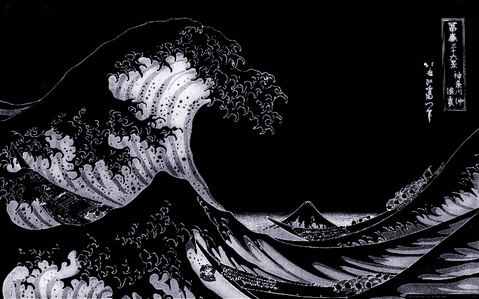
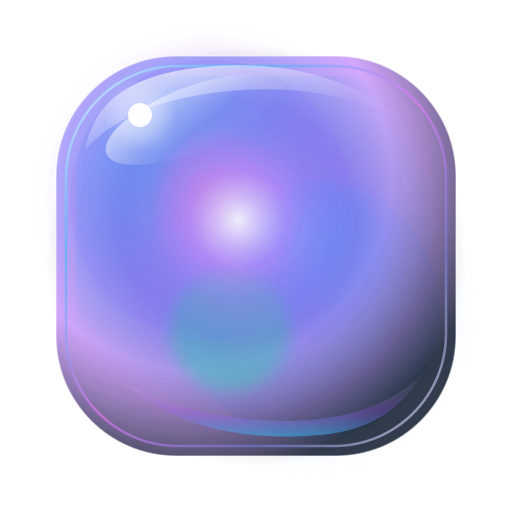

# 🌌 Cyberdeck // Violet Startpage

<p align="center">
  
</p>

<p align="center">
  <b>Une page de démarrage (startpage) ultralégère, moderne et immersive centrée exclusivement sur vos raccourcis et favoris web.</b>
</p>

<p align="center">
  
  
  
  
  
</p>

---

## 📸 Thèmes Visuels & Design

La startpage intègre **5 thèmes visuels** avec éclairage ambiant (Ambilight), orbes lumineux et animations spécialisées, sélectionnables via les touches (<kbd>1</kbd>, <kbd>2</kbd>, <kbd>3</kbd>, <kbd>4</kbd>, <kbd>5</kbd>) ou dans le centre de configuration :

| Thème 1 : Kanagawa 🌊 | Thème 2 : Sakura 🌸 | Thème 3 : Cyberdeck ⚡ | Thème 4 : Retro Wave 🎮 | Thème 5 : Liquid Glass 💎 |
| :---: | :---: | :---: | :---: | :---: |
|  |  |  |  |  |
| *Cyan & Menthe froide* | *Rose & Néo-Pastel* | *Violet & Néon Cyberdeck* | *Monochrome Ukiyo & 8-Bit* | *Apple Liquid Glass & Reflets* |

---

## ⚡ Fonctionnalités Clés

### 🔗 Grille des Raccourcis Web & Favoris
- **Densité adaptative automatique** : Ajustement dynamique de la taille et de l'espacement pour afficher confortablement n'importe quel nombre de liens sans déborder.
- **Glisser-Déposer (Drag & Drop)** : Réorganisation fluide au sein d'une même catégorie ou déplacement d'une catégorie à l'autre.
- **Ajout & Édition complets** : Formulaire modal avec sélection d'icônes Font Awesome, choix de catégorie, prévisualisation en temps réel.
- **Annulation rapide (<kbd>Ctrl+Z</kbd>)** : Restauration immédiate en cas de suppression accidentelle d'un raccourci.

### 🔍 Barre de Recherche Intelligente (Omnibox)
- Touche <kbd>/</kbd> pour cibler instantanément le champ.
- **Bangs & Moteurs de recherche** : `!yt` (YouTube), `!gh` (GitHub), `!tr` (DeepL), `!maps` (Google Maps), `!img` (Images), `!w` (Wikipédia), `!d` (DuckDuckGo), `!so` (StackOverflow), `!r` (Reddit).
- **Calculatrice en direct** : Évalue les expressions mathématiques au cours de la frappe.

### ⌨️ Palette de Commandes (<kbd>Ctrl+K</kbd> ou <kbd>B</kbd>)
- Recherche textuelle instantanée dans l'intégralité de vos signets et catégories.
- Navigation au clavier avec <kbd>↑</kbd>, <kbd>↓</kbd> et ouverture avec <kbd>Entrée</kbd>.

### ⚙️ Centre de Personnalisation
- **Apparence** : Choix des thèmes, réglage RGB des accents néon, intensité et flou de l'Ambilight, scanlines cathodiques rétro, mode nuit (<kbd>Ctrl+Shift+D</kbd>).
- **Gestion des Catégories** : Création, renommage, suppression et suivi du nombre de liens.
- **Animations & Fluidité** : Styles de transitions (Deck Slide, Page Zoom, Cyber Scan, Fondu), vitesse et flou cinétique.
- **Sauvegarde & Restauration** : Export et import de l'intégralité de votre configuration dans un fichier JSON.

---

## 🚀 Utilisation Locale

Ouvrez simplement `index.html` dans votre navigateur ou lancez un serveur HTTP léger :

```bash
python3 -m http.server 3000
```
Puis accédez à `http://localhost:3000`.
