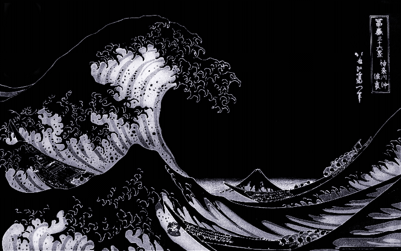

# 🌌 Cyberdeck / Violet Startpage

<p align="center">
  
</p>

<p align="center">
  <b>Une page d'accueil (startpage) modulaire, moderne et immersive conçue pour booster votre productivité tout en sublimant votre navigateur.</b>
</p>

<p align="center">
  
  
  
  
  
</p>

---

## 📸 Thèmes Visuels

La startpage intègre 4 thèmes visuels avec éclairage ambiant (Ambilight), orbes lumineux et scanlines rétro, sélectionnables via les raccourcis clavier (<kbd>1</kbd>, <kbd>2</kbd>, <kbd>3</kbd>, <kbd>4</kbd>) ou dans le centre de configuration :

| Thème 1 : Kanagawa 🌊 | Thème 2 : Sakura 🌸 | Thème 3 : Cyberdeck ⚡ | Thème 4 : Retro Wave 🎮 |
| :---: | :---: | :---: | :---: |
|  |  |  |  |
| *Palette Cyan & Menthe froide* | *Palette Rose & Néo-Pastel* | *Palette Cyberpunk Violet & Néon* | *Palette Monochrome Ukiyo & 8-Bit* |

---

## 📐 Architecture de l'Interface (Cockpit Dashboard avec Menu Latéral)

Le tableau de bord est structuré en **Dashboard moderne de type cockpit** avec navigation latérale et topbar HUD discrète :

1. **Menu Latéral Gauche (Sidebar Slim & Rétractable)** :
   - Mode compact par défaut avec icônes épurées (~68px) et infobulles flottantes (tooltips).
   - Dépliable par survol ou verrouillable en mode étendu via le bouton chevron.
   - **Navigation rapide aux flèches clavier (<kbd>↑</kbd> / <kbd>↓</kbd>)** permettant de basculer instantanément d'un onglet à l'autre.
   - Indicateur lumineux vertical glissant avec animation fluide.
   - Actions rapides : Mode Nuit / Atténuation HUD (<kbd>Ctrl+Shift+D</kbd>), cyclage de thème et palette de commandes (<kbd>Ctrl+K</kbd>).

2. **Topbar HUD Minimaliste** :
   - Titre et icône dynamique de l'onglet actif.
   - Déclencheur rapide de recherche (<kbd>/</kbd>).
   - Pastilles interactives de télémétrie : météo en direct, bouton play/pause audio Lo-Fi et nom du thème actif.

3. **Espace de Travail Spacieux (10 Vues Plein Format)** :
   - **Accueil (Vue Générale)** : Barre Omnibox + Grande station horloge HUD + Grille spacieuse des signets et catégories.
   - **Agenda & Tâches** : Calendrier mensuel interactif à gauche et To-Do list complète à droite.
   - **Météo & Radar** : Courbe de température & pluie 24h, métriques détaillées, prévisions sur 3j et radar satellite en direct.
   - **Actualités** : Lecteur de flux d'actualités F1, Football, Tech et vos flux RSS sur mesure.
   - **Système & Marchés** : Latence ping en temps réel (sparkline SVG), batterie, uptime et indices boursiers.
   - **Focus Pomodoro** : Minuteur circulaire avec presets, carillon et jalons de session.
   - **Dev Studio & Bloc-Notes** : Playground multi-langages (Python, C, Oz, Java, JS), terminal interactif et moteur d'exécution local ultra-rapide (`./runner.py`).
   - **Ambiance Lo-Fi** : Synthèse audio procédurale et radio avec visualiseur Canvas.
   - **Citations** : Citations de culture hacker, dev et cyberpunk.
   - **Paramètres** : Centre complet de personnalisation des thèmes, de l'horloge et sauvegarde JSON.

---

## ✨ Fonctionnalités

### ⏱️ Station Horloge Cyberdeck (Chrono-HUD) — `js/clock.js`
- **Cadran central interactif** :
  - Arc circulaire des secondes SVG avec animation continue à 60 FPS.
  - Micro-compteur de millisecondes (`.ms`) et repères cardinaux tachymétriques.
  - Horloge au format 24h ou 12h avec pastille AM/PM.
- **Télémétrie calendaire & solaire** :
  - Affichage complet de la date en français.
  - Puces télémétriques : numéro de semaine (`Sem. 45`), jour de l'année (`Jour 308/365`) et cycle solaire dynamique (☀️ Diurne / 🌙 Nocturne).
- **Progression de la journée (%)** :
  - Jauge visuelle animée avec pourcentage exact et calcul en temps réel du temps restant (`Xh Ym restants`).
- **Sélecteur de fuseaux horaires** :
  - Défilement au clic ou sélection par menu : Local (Paris), Tokyo (JST), New York (EST), Londres (GMT), UTC.
- **Typographies & Styles au choix** :
  - 5 polices : *JetBrains Mono*, *Orbitron*, *Share Tech Mono*, *VT323*, *Inter*.
  - 6 styles de cadre : *HUD Cyberdeck*, *Lueur Intense Néon*, *Digital Box LCD*, *Pilule Verre*, *Crochets Cyber [ ]*, *Minimaliste*.

### 📅 Agenda & Gestionnaire de Tâches — `js/calendar.js` & `js/tasks.js`
- **Mini-calendrier mensuel interactif** :
  - Navigation par mois avec bouton de retour à aujourd'hui.
  - Badges du nombre de tâches incrustés directement sur chaque jour du calendrier.
  - Clic sur un jour pour filtrer immédiatement la liste des tâches sur cette date précise.
- **Gestionnaire de tâches (To-Do List)** :
  - Ajout rapide avec libellé et date d'échéance optionnelle.
  - Calcul dynamique des échéances : `Auj.`, `Demain`, `J-X` (à venir), `J+X` (en retard).
  - Onglets de filtrage rapide : `Toutes`, `À faire`, `Faites`.
  - Mini-jauge de progression globale indiquant le ratio de tâches complétées (`X / Y`).
  - Vue d'état vide ergonomique lors de l'accomplissement de toutes les tâches.

### 🔍 Barre de Recherche Intelligente (Omnibox) — `js/search.js`
- **Raccourci clavier instantané** : Touche <kbd>/</kbd> pour cibler immédiatement le champ de recherche.
- **Moteurs de recherche & Préfixes rapides (Bangs)** :
  - `!yt <requête>` : YouTube
  - `!gh <requête>` : GitHub
  - `!tr <texte>` : Traduction DeepL
  - `!maps <lieu>` : Google Maps
  - `!img <terme>` : Google Images
  - `!w <terme>` : Wikipédia
  - `!d <requête>` : DuckDuckGo
  - `!so <requête>` : StackOverflow
  - `!arch <sujet>` : ArchWiki
  - `!r <terme>` : Reddit
  - `!help` : Afficher l'aide des commandes
- **Calculatrice en direct** : Évalue les expressions mathématiques (`15 * 4`, `(120/4) + 8`) instantanément pendant la frappe.
- **Suggestions de recherche** : Autocomplétion Google navigable au clavier avec les flèches <kbd>↑</kbd> et <kbd>↓</kbd>.

### ⚡ Grille des Signets & Catégories — `js/bookmarks.js`
- **Densité adaptative automatique** : Ajustement dynamique de la taille et de l'espacement pour afficher plus de 6 liens par catégorie sans déborder.
- **Ajout & Gestion complète** : Création, modification et suppression de catégories et de liens avec sélection d'icônes Font Awesome.
- **Glisser-Déposer (Drag & Drop)** : Réorganisation libre des liens au sein d'une même catégorie ou déplacement d'une catégorie à l'autre.
- **Export & Import JSON** : Sauvegarde intégrale en 1 clic de votre configuration dans un fichier `.json` et restauration immédiate.

### 🌤️ Station Météo Complète & Effets Canvas — `js/weather.js` & `js/weather-fx.js`
- **Données en direct** : Température actuelle, température ressentie, humidité, vitesse du vent, indice UV.
- **Prévisions à 3 jours** avec températures minimales et maximales.
- **Recherche de ville & Géolocalisation** : Recherche manuelle par nom de ville ou détection automatique de localisation par IP.
- **Effets météo d'arrière-plan** : Particules Canvas réactives (pluie, neige, orage, brume, ciel étoilé) avec interrupteur ON/OFF.

### ⏱️ Minuteur Focus / Pomodoro — `js/widgets.js`
- Cadran circulaire avec anneau de progression SVG.
- Modes de travail prédéfinis : Focus (25m), Pause courte (5m), Pause longue (15m).
- Boutons de presets d'intervalles : `25/5 Standard`, `50/10 Deep Work`, `15/3 Sprint`.
- Compteur de sessions et objectif journalier représenté par 4 jalons visuels.
- Carillon harmonique Web Audio à l'achèvement de chaque session.

### 📝 Bloc-Notes Instantané (Scratchpad) — `js/widgets.js`
- Zone de saisie rapide plein format avec auto-sauvegarde continue dans `localStorage`.
- Compteur en temps réel des mots et des caractères.
- Actions directes : copier dans le presse-papier, exporter au format `.txt`, et effacer.

### 🎧 Ambiance Sonore Procédurale & Lo-Fi — `js/widgets.js`
- 6 ambiances audio au choix :
  - 🌧️ Pluie Cyber (Pluie douce synthétisée)
  - ☕ Lo-Fi Synth (Lounge relax)
  - 🌌 Deep Space (Bruit brun spatial profond)
  - ⚡ Orage Néon (Pluie et tonnerre)
  - 📻 Radio Lo-Fi (Flux radio continu chillhop)
  - 🍃 Nuit Synthé (Brise nocturne et résonance)
- Visualiseur de spectre audio animé sur Canvas et réglage précis du volume.

### ⚡ Moniteur Système & Marchés Financiers — `js/widgets.js`
- Télémétrie système : Latence ping réseau (ms), statut d'alimentation (AC / Batterie), nombre de cœurs CPU, mémoire vive (RAM), et temps de session (uptime).
- Ticker des marchés boursiers : Suivi des indices majeurs (S&P 500, Europe Stoxx 600, Marchés Émergents, NVIDIA...) avec menu de personnalisation pour activer, masquer ou ajouter des actifs.

### 💬 Citations Cyberpunk & Motivation — `js/widgets.js`
- Sélection de citations issues de la science-fiction, de la culture hacker et de la philosophie dev (Blade Runner, Ghost in the Shell, Matrix, Neuromancer).
- Bouton de tirage aléatoire et copie rapide dans le presse-papier.

### ⚙️ Centre de Configuration Intégré — `js/custom-hub.js`
- Accès direct via l'onglet **Config** de la colonne droite :
  - **Apparence** : Choix des 3 thèmes, 10 palettes rapides, sélecteurs de couleurs personnalisés, intensité de l'Ambilight, scanlines rétro, avec aperçu en temps réel sur la page.
  - **Horloge** : Choix de la police, du style de cadre, des formats d'heure et de date, et des fuseaux horaires.
  - **Signets** : Gestion complète des catégories et favoris.
  - **Widgets** : Activation et désactivation individuelle de chaque widget.
  - **Flux RSS** : Gestion et validation d'URL pour vos flux d'actualités sur mesure.
  - **Sauvegarde** : Téléchargement du fichier de configuration JSON, restauration et remise à zéro.

---

## 🏗️ Structure du Projet

```text
violet-startpage/
├── index.html                  # Structure HTML cyberdeck 3 colonnes
├── README.md                   # Documentation complète du projet
├── .gitignore                  # Fichiers exclus de Git
│
├── css/                        # Feuilles de styles
│   ├── style.css               # Styles de base, Bento Grid, widgets et responsive
│   └── themes/                 # Thèmes visuels
│       ├── kanagawa.css        # Thème 1 : Kanagawa (Cyan / Menthe froide)
│       ├── sakura.css          # Thème 2 : Sakura (Rose / Néo-pastel)
│       ├── cyberdeck.css       # Thème 3 : Cyberdeck (Néon violet & cyan)
│       └── retrowave.css       # Thème 4 : Retro Wave (Monochrome Ukiyo & 8-Bit)
│
├── js/                         # Modules JavaScript
│   ├── app.js                  # Point d'entrée de l'application
│   ├── themes.js               # Gestionnaire des thèmes
│   ├── appearance.js           # Personnalisation des couleurs, ambilight et scanlines
│   ├── clock.js                # Station horloge HUD, arc radial, cycle solaire & fuseaux
│   ├── calendar.js             # Mini-calendrier mensuel avec badges de tâches
│   ├── tasks.js                # To-Do list, échéances et filtrage
│   ├── search.js               # Omnibox : moteur, calculatrice, bangs & autocomplétion
│   ├── bookmarks.js            # Signets adaptatifs, Drag & Drop & Export/Import JSON
│   ├── weather.js              # Station météo in-deck & géolocalisation
│   ├── weather-fx.js           # Effets météo dynamiques sur Canvas
│   ├── widgets.js              # Widgets (Pomodoro, Notes, Ambiance, Système, Quotes)
│   ├── feeds.js                # Flux d'actualités en direct & flux RSS personnalisés
│   ├── custom-hub.js           # Centre de configuration in-deck & navigation à 9 vues
│   └── shortcuts.js            # Raccourcis clavier globaux
│
└── images/                     # Médias et animations des thèmes
    ├── gif.gif                 # Artwork Thème 1 (Kanagawa)
    ├── gif2.gif                # Artwork Thème 2 (Sakura)
    ├── gif3.gif                # Artwork Thème 3 (Cyberdeck)
    ├── gif4.gif                # Artwork Thème 4 (Retro Wave)
    └── gif_origin.gif
```

---

## ⌨️ Raccourcis Clavier

| Raccourci | Action |
| :--- | :--- |
| <kbd>↑</kbd> / <kbd>↓</kbd> | Naviguer entre les onglets de la sidebar (quand aucun champ texte n'est actif) |
| <kbd>Alt+1</kbd> à <kbd>Alt+0</kbd> | Accès direct aux 10 onglets du Dashboard |
| <kbd>/</kbd> | Activer la barre de recherche Omnibox |
| <kbd>Ctrl+K</kbd> ou <kbd>B</kbd> | Ouvrir la palette de commandes globale |
| <kbd>Ctrl+Shift+D</kbd> | Basculer le mode Nuit / Atténuation HUD |
| <kbd>1</kbd>, <kbd>2</kbd>, <kbd>3</kbd>, <kbd>4</kbd> | Basculer instantanément entre les 4 thèmes visuels |
| <kbd>T</kbd> | Ajouter rapidement une tâche (active l'agenda et cible le champ) |
| <kbd>Entrée</kbd> | Valider une recherche, ajouter une tâche ou enregistrer |
| <kbd>Échap</kbd> | Fermer les modales ou quitter le champ actif |

---

## 🚀 Installation & Utilisation

### Option A : Utilisation locale (Recommandée)
1. Clonez ce dépôt ou téléchargez l'archive :
   ```bash
   git clone https://github.com/ugovds/startup_page.git
   ```
2. Ouvrez le fichier `index.html` dans votre navigateur Web (Firefox, Chrome, Brave, Edge...).
3. Pour l'assigner comme page d'accueil ou nouvel onglet :
   - Utilisez une extension telle que **New Tab Override** ou **Custom New Tab URL**.
   - Renseignez l'URL locale : `file:///chemin/vers/index.html`.

### Option B : Déploiement en ligne gratuit (GitHub Pages)
1. Rendez-vous sur votre dépôt GitHub : [https://github.com/ugovds/startup_page](https://github.com/ugovds/startup_page).
2. Ouvrez **Settings** > **Pages**.
3. Sous **Branch**, sélectionnez `main` et le dossier `/ (root)`, puis validez avec **Save**.
4. Votre startpage sera accessible en ligne à l'adresse :
   ```text
   https://ugovds.github.io/startup_page/
   ```

---

## ⚡ Moteur d'Exécution Local & Compilateurs Natifs (`./runner.py`)

Pour exécuter instantanément votre code (C, Java, Python, Oz, JS, Bash) directement avec les compilateurs de votre PC en **10 à 25 ms** (comme dans VS Code ou IntelliJ) :

```bash
./runner.py
# ou : python3 runner.py 3000
```

Ouvrez ensuite [http://localhost:3000](http://localhost:3000) dans votre navigateur.
Le dashboard détecte automatiquement vos compilateurs natifs (`/usr/bin/gcc`, `/usr/bin/javac`, `/usr/bin/python3`, `/usr/bin/ozc`) et route toutes les exécutions localement.

---

## 🎨 Création d'un Nouveau Thème

Pour ajouter un thème supplémentaire :
1. Créez un fichier `css/themes/mon-theme.css` avec vos variables CSS :
   ```css
   body[data-theme="4"] {
     --bg-deep: #0a0e14;
     --accent-primary: #ffaa00;
     --accent-secondary: #00e5ff;
     --surface: rgba(10, 14, 20, 0.75);
     --border-subtle: rgba(255, 170, 0, 0.15);
     --border-highlight: rgba(255, 170, 0, 0.45);
   }
   ```
2. Liez le fichier dans `index.html`.
3. Déclarez le nom du thème et son artwork dans `js/themes.js`.
